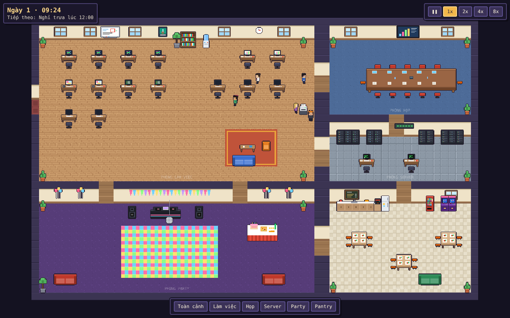

# 🏢 AI Pixel Office

Văn phòng pixel art động chạy trên trình duyệt (PC + điện thoại). Mỗi nhân vật là một **vai trò** trong công ty phần mềm và tự sinh hoạt theo lịch: đi làm, standup, ghé bàn đồng nghiệp, pha cà phê, ăn trưa, sprint review, quẩy happy hour rồi về nhà.



**Tech:** [Phaser 3](https://phaser.io) + [Vite](https://vite.dev). Toàn bộ hình ảnh hiện tại được **vẽ bằng code** (chưa cần file ảnh), sau này có thể thay bằng asset từ itch.io.

---

## 1. Cài đặt (Windows)

### Bước 1: Cài Node.js
Mở **PowerShell** rồi chạy:
```powershell
winget install OpenJS.NodeJS.LTS
```
(hoặc tải bản **LTS** tại https://nodejs.org). Cài xong thì **đóng PowerShell, mở lại** và kiểm tra:
```powershell
node -v
npm -v
```

### Bước 2: Lấy code về
```powershell
git clone https://github.com/henrywizzrd/ai-pixel-office.git
cd ai-pixel-office
```
(Nếu tải file zip thì giải nén rồi `cd` vào thư mục đó.)

### Bước 3: Cài thư viện và chạy
```powershell
npm install
npm run dev
```
Mở trình duyệt vào **http://localhost:5173**.

> Xem trên điện thoại: điện thoại và máy tính cùng Wi-Fi, mở địa chỉ `Network: http://192.168.x.x:5173` mà terminal in ra.

### Build bản tĩnh (để deploy GitHub Pages / Netlify)
```powershell
npm run build
```
Kết quả nằm trong thư mục `dist/`.

---

## 2. Điều khiển

| Thao tác | PC | Điện thoại |
|---|---|---|
| Di chuyển camera | Kéo chuột / WASD / phím mũi tên | Vuốt 1 ngón |
| Zoom | Lăn chuột / Q, E | Chụm 2 ngón |
| Xem thông tin nhân vật | Bấm vào nhân vật | Chạm vào nhân vật |
| Chuyển phòng | Thanh nút dưới cùng | Thanh nút dưới cùng |
| Tốc độ thời gian | ❚❚ 1x 2x 4x 8x (góc phải trên) | như PC |

Tên nhân vật chỉ hiện khi zoom gần để đỡ rối mắt.

---

## 3. Văn phòng có gì

**Phòng:** Làm việc · Họp · Server · Party · Pantry

**Nhân viên (12 người):** 4 Dev · 2 Designer · 2 Tester · 1 PM · 1 BA · 2 DevOps

**Lịch một ngày** (1 giây thực = 1 phút trong game ở tốc độ 1x):

| Giờ | Sự kiện |
|---|---|
| 07:50 – 08:40 | Lần lượt đến công ty |
| 09:00 – 09:20 | Daily standup (tất cả) |
| 12:00 – 13:00 | Ăn trưa ở pantry |
| 15:00 – 15:45 | Sprint review (PM, Dev, Tester, BA, Designer) |
| 17:30 – 18:40 | Happy hour ở phòng party |
| 18:40 | Tan làm |

Thời gian rảnh, mỗi vai trò tự chọn việc theo tỉ lệ riêng: làm việc, pha cà phê, lấy nước, ra máy in, chơi arcade, hoặc ghé bàn đồng nghiệp (Tester đi báo bug cho Dev, Designer đi soi pixel, PM đi hỏi tiến độ...).

---

## 4. Cấu trúc code

```
src/
├── main.js                 # Khởi tạo Phaser
├── bus.js                  # Kênh sự kiện giữa game và HUD
├── scenes/
│   └── OfficeScene.js      # Scene chính: dựng map, nội thất, camera, vòng lặp
├── world/
│   ├── map.js              # Lưới bản đồ, toạ độ phòng, cửa
│   ├── office.js           # Vị trí nội thất, bàn, ghế, điểm đứng
│   └── pathfinding.js      # Tìm đường BFS
├── agents/
│   ├── roles.js            # Vai trò, câu thoại, danh sách nhân viên
│   ├── schedule.js         # Lịch sự kiện trong ngày
│   ├── Director.js         # "Bộ não": giao việc theo lịch và vai trò
│   └── Agent.js            # Một nhân vật: di chuyển, tư thế, bong bóng chat
├── art/
│   ├── pixel.js            # Công cụ vẽ pixel
│   ├── tiles.js            # Tileset sàn, tường
│   ├── furniture.js        # Nội thất
│   └── characters.js       # Sprite nhân vật (9 frame/người)
└── ui/
    ├── hud.js              # Nối HUD HTML với game
    └── hud.css
```

---

## 5. Tuỳ chỉnh nhanh

**Thêm nhân viên mới**
1. `src/agents/roles.js` → thêm 1 dòng vào mảng `AGENTS`, ví dụ:
   `{ id: 'dev5', name: 'Tú', role: 'dev', skin: SKIN[1], hair: HAIR.brown, hairStyle: 'short' },`
2. `src/world/office.js` → thêm bàn cho id đó vào object `DESKS`, ví dụ:
   `dev5: { tx: 24, ty: 9, screen: 'code' },`
   (nhớ xoá bàn trùng toạ độ trong `SPARE_DESKS`)

**Thêm vai trò mới:** thêm một mục vào `ROLES` trong `src/agents/roles.js`, rồi thêm tỉ lệ việc rảnh vào `FREE_WEIGHTS` trong `src/agents/Director.js`.

**Đổi lịch:** sửa mảng `EVENTS` trong `src/agents/schedule.js`.

**Đổi câu thoại:** sửa các mảng `work`, `visit`, `reply` trong `ROLES` và `COMMON_LINES` trong `src/agents/roles.js`.

---

## 6. Lộ trình tiếp theo

- [x] Bản đồ nhiều phòng + nội thất
- [x] 12 nhân vật theo vai trò, có lịch sinh hoạt
- [x] Bong bóng chat, ngày/đêm, đèn disco
- [x] Điều khiển camera cho PC + điện thoại
- [ ] Thay hình bằng asset itch.io (dựng map bằng [Tiled](https://www.mapeditor.org))
- [ ] Chỉnh lại sprite nhân vật trong Aseprite
- [ ] Âm thanh: tiếng gõ phím, nhạc party
- [ ] Sự kiện ngẫu nhiên: server sập, deadline gấp, sinh nhật
- [ ] Lưu cài đặt, chọn nhân vật để theo dõi mặc định
- [ ] Deploy lên GitHub Pages
